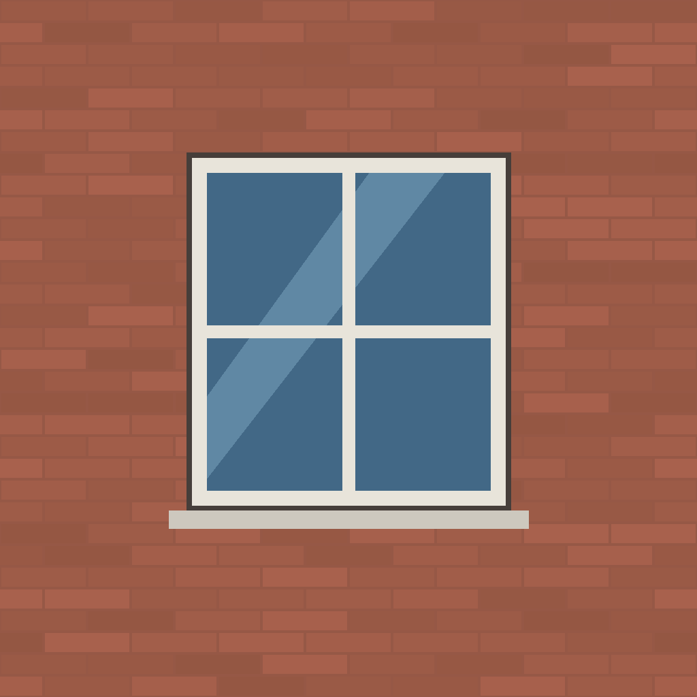
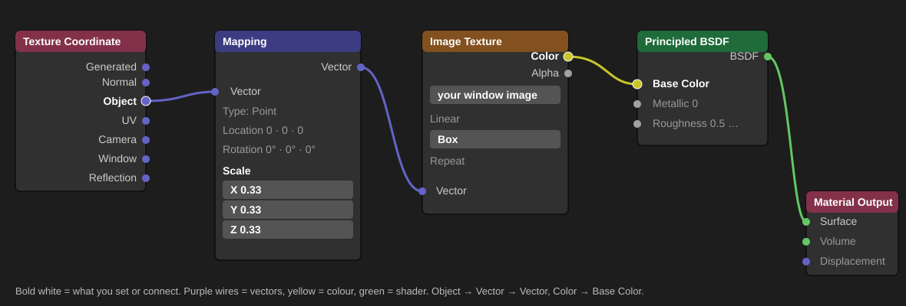

You turn the default cube into a four-storey apartment building. A repeating window picture covers every wall using **Box projection** and **Object coordinates**. That means you can make the building bigger in Edit Mode and the windows **stay the same size** instead of stretching. No UV unwrapping is needed. These steps are for Blender 5.2. Every part has a ▶ link that jumps the video to that step.

**You need:** the window picture, [**apartment_window_tile.png**](apartment_window_tile.png). Click the link, then right-click the picture and choose **Save image as**. (On a phone, press and hold it.) Any picture of a window works too. Save it where you can find it.



| Colour | Meaning |
| --- | --- |
| Green | Safe to change. No real effect on speed. |
| Amber | Raises the load a little. Fine at the values given. |
| Red | Use with caution. Big effect on speed or memory. |

This lesson has no amber or red settings.

### Where things are

| Thing | Where on the screen |
| --- | --- |
| **Shading** tab | Top of the window, in the row of workspace tabs (Layout, Modeling, … Shading) |
| **Shader Editor** (node area) | Bottom half of the Shading workspace |
| **3D Viewport** | Top half of the Shading workspace |
| **Sidebar** (N panel) | Right edge of the 3D Viewport. **View → Sidebar** (Shortcut: N) |
| **Material Properties** | Properties editor (bottom-right), the red sphere icon |
| **Face Select** button | Top-left of the 3D Viewport, third of the three small square buttons (Edit Mode only) |

In the node area: roll the mouse wheel to zoom, hold the wheel and drag to slide around.

```brief
Part 1 · The window picture
1 · Image | Shading tab · Add → Texture → Image Texture | Open window picture · Color → Base Color | [▶ 0:19](https://youtu.be/bkRdBT-urf8?t=19)
Part 2 · Coordinates and size
2A · Coordinates | Add → Input → Texture Coordinate | Add → Vector → Mapping between | Object → Vector → Vector | [▶ 1:43](https://youtu.be/bkRdBT-urf8?t=103)
2B · Box | Image Texture: Flat → Box | Windows on every side | [▶ 1:28](https://youtu.be/bkRdBT-urf8?t=88)
2C · Size | Mapping Scale 0.33 · 0.33 · 0.33 | [▶ 2:19](https://youtu.be/bkRdBT-urf8?t=139)
Part 3 · Make it a building
3A · Scale in Edit Mode | Select → All · S 3 · S Z 2 | Windows keep their size | [▶ 3:00](https://youtu.be/bkRdBT-urf8?t=180)
3B · Check | Object Mode · Dimensions 6 · 6 · 12 | [▶ 3:51](https://youtu.be/bkRdBT-urf8?t=231)
3C · Line up | Mapping Location X · Y · Z | Reset to 0 | [▶ 4:07](https://youtu.be/bkRdBT-urf8?t=247)
Part 4 · The roof
4A · Roof colour | Top face · + slot · New → Roof · grey | Assign | [▶ 4:34](https://youtu.be/bkRdBT-urf8?t=274)
4B · Flat roof | Inset (I) · Extrude (E) down a little | [▶ 5:13](https://youtu.be/bkRdBT-urf8?t=313)
Part 5 · More building
5A · Extrude | Side face · E 6 | Another block of apartments | [▶ 5:38](https://youtu.be/bkRdBT-urf8?t=338)
5B · Duplicate | Select → All · Shift+D · Y | [▶ 6:13](https://youtu.be/bkRdBT-urf8?t=373)
Part 6 · Light and render
6A · Lights | Object Mode · light · Shift+D · move | [▶ 6:45](https://youtu.be/bkRdBT-urf8?t=405)
6B · Render | Lock Camera to View · frame it · F12 | [▶ 7:06](https://youtu.be/bkRdBT-urf8?t=426)
```

**The finished node tree.** Four nodes plus the Material Output. Read it left to right: the **Object** position of each point goes through **Mapping** (which sets the size) into the **Image Texture** (which wraps the picture on with **Box**), and its **Color** colours the building.



## Part 1 · The window picture

[▶ Watch this part (0:19)](https://youtu.be/bkRdBT-urf8?t=19)

| Image Texture | Value |
| --- | --- |
| Image | your window picture |
| Interpolation | Linear |
| Projection | Flat (for now) |
| Extension | Repeat |

Connect **Color** → Principled BSDF **Base Color**.

1. Choose **File → New → General**. Choose **File → Save As** and name it `apartment_yourname.blend`.
2. Click the **Shading** tab at the top of the window. The bottom half is the **Shader Editor**. It shows two nodes for the cube's material: **Principled BSDF** and **Material Output**.
3. Both nodes are selected (orange outline). Click an empty spot in the node area to deselect them.
4. Move your mouse into the node area and choose **Add → Texture → Image Texture**. Click to drop it to the left of Principled BSDF. (Shortcut: Shift+A, then type "image")
5. Click **Open** on the new node and find your window picture. A small preview shows on the node.
6. Drag from the yellow **Color** dot to the yellow **Base Color** dot. The cube in the viewport shows the window picture.

> **Pick the right one:** **Image Texture**, not **Environment Texture** (that one is for the sky) and not **Image** in the Input list.

- [ ] The cube shows the window picture
- [ ] The Image Texture's Color wire goes to Base Color

## Part 2 · Coordinates and size

### 2A · Texture Coordinate and Mapping

[▶ Watch this part (1:43)](https://youtu.be/bkRdBT-urf8?t=103)

1. Choose **Add → Input → Texture Coordinate** and drop it far to the left. (Shortcut: Shift+A, type "texture coordinate")
2. Choose **Add → Vector → Mapping** and drop it between Texture Coordinate and Image Texture.
3. Drag from **Object** (Texture Coordinate) to **Vector** (the input on the left of Mapping).
4. Drag from Mapping's **Vector** output (right side) to the Image Texture's **Vector** input. The picture on the cube changes: some sides now look smeared.

> **Pick the right one:** Use the **Object** dot on Texture Coordinate, not **Generated** or **UV**. Object coordinates are what keep the windows the same size when the building grows. **Mapping** is in **Vector**, not **Vector Math**.

### 2B · Box projection

[▶ Watch (1:28)](https://youtu.be/bkRdBT-urf8?t=88)

1. On the **Image Texture** node, change **Flat** to **Box**. The smeared sides fix themselves: every wall now shows windows.

**What it does:** Box wraps the picture onto all six sides like wrapping paper on a box, so no side gets stretched.

### 2C · Window size

[▶ Watch (2:19)](https://youtu.be/bkRdBT-urf8?t=139)

| Mapping | Value |
| --- | --- |
| Type | Point |
| Location | 0, 0, 0 |
| Rotation | 0°, 0°, 0° |
| **Scale** | **0.33**, **0.33**, **0.33** |

1. On the **Mapping** node, click in **Scale X**, drag straight down over **Y** and **Z**, type **0.33** and press **Enter**. The windows shrink and repeat: about three across each side.

- [ ] Every side of the cube shows a grid of whole windows
- [ ] Mapping Scale is 0.33 in X, Y and Z

## Part 3 · Make it a building

### 3A · Scale it in Edit Mode

[▶ Watch this part (3:00)](https://youtu.be/bkRdBT-urf8?t=180)

1. Drag the line between the viewport and the node area down to make the viewport bigger.
2. If the cube looks plain grey, click **Material Preview** (third shading circle, top-right of the viewport). (Shortcut: Z → Material Preview)
3. Hover over the viewport and switch to **Edit Mode**. Click **Face Select**. (Shortcut: Tab, then 3)
4. Choose **Select → All**. (Shortcut: A)
5. Choose **Mesh → Transform → Scale**, type **3** and press **Enter**. The cube grows three times bigger, but the **windows stay the same size**: there are more of them now. (Shortcut: S, 3, Enter)
6. Press **S**, then **Z**, type **2** and press **Enter**. The building gets twice as tall with more floors of windows.

> **Why Edit Mode?** Scaling in Edit Mode changes the points themselves, so the Object coordinates grow with them and the pattern keeps repeating. Scaling in Object Mode would stretch the windows.

### 3B · Check the size

[▶ Watch (3:51)](https://youtu.be/bkRdBT-urf8?t=231)

| Sidebar → Item → Dimensions | Value |
| --- | --- |
| X | 6 m |
| Y | 6 m |
| Z | 12 m |

1. Switch to **Object Mode**. (Shortcut: Tab)
2. Open the **Sidebar** and look at **Dimensions** on the **Item** tab. They should match the table.

### 3C · Line up the windows

[▶ Watch (4:07)](https://youtu.be/bkRdBT-urf8?t=247)

1. If the windows are cut in half at a corner or at the bottom, drag **Location X** on the Mapping node. The windows slide along the sides. Try **Y** and **Z** too.
2. To undo your changes, drag over all three Location fields, type **0** and press **Enter**.

- [ ] The building is 6 × 6 × 12 m with whole windows on every side

## Part 4 · The roof

### 4A · Roof colour

[▶ Watch this part (4:34)](https://youtu.be/bkRdBT-urf8?t=274)

| Roof material | Value |
| --- | --- |
| Name | Roof |
| Base Color | grey |

1. Click the building, switch to **Edit Mode**, and click the **top face**. It turns orange.
2. Open **Material Properties** (red sphere icon). Click **+** beside the material list to add a slot, then click **New**. Double-click the name and type **Roof**.
3. Click the **Base Color** box and drag the brightness bar down to a grey you like. Click away.
4. Click **Assign**. The top of the building turns grey.

> **Pick the right one:** Click **+** first, then **New**. If you click New on the first slot, the whole building turns grey.

### 4B · A flat roof with a lip

[▶ Watch (5:13)](https://youtu.be/bkRdBT-urf8?t=313)

1. With the top face still selected, move your mouse away from the building. Choose **Face → Inset Faces** and move the mouse in a little. Click. A smaller face appears inside the roof. (Shortcut: I)
2. Choose **Mesh → Extrude → Extrude Faces**, press **Z** and move down a little. Click. The middle of the roof sinks and leaves a lip around the edge. (Shortcut: E, then Z)

This is optional, but it makes the roof look more real.

- [ ] The roof is grey, with a raised edge around it

## Part 5 · More building

### 5A · Extrude a new block

[▶ Watch this part (5:38)](https://youtu.be/bkRdBT-urf8?t=338)

1. In **Edit Mode**, spin the view and click one **side face** of the building.
2. Press **E**, type **6** and press **Enter**. A new 6 m block of apartments grows out of that side, with windows already on it.
3. Do it again if you want a longer building.

### 5B · Duplicate the building

[▶ Watch (6:13)](https://youtu.be/bkRdBT-urf8?t=373)

1. Choose **Select → All**, then **Mesh → Duplicate**. Press **Y** so it only moves along Y, move it and click. (Shortcut: A, Shift+D, Y)

The video tries this for the first time. Doing it in **Object Mode** with **Object → Duplicate Objects** makes a separate building you can move on its own.

- [ ] I have a longer building or a second building

## Part 6 · Light and render

### 6A · More lights

[▶ Watch this part (6:45)](https://youtu.be/bkRdBT-urf8?t=405)

1. Switch to **Object Mode**. Click the **Light**.
2. Choose **Object → Duplicate Objects** and move the copy down and to a side that looks dark. Click. (Shortcut: Shift+D)
3. Duplicate again and move it to the other side.

### 6B · Frame and render

[▶ Watch (7:06)](https://youtu.be/bkRdBT-urf8?t=426)

1. Choose **View → Cameras → Active Camera**. (Shortcut: Numpad 0)
2. In the **Sidebar**, click the **View** tab and tick **Lock Camera to View**. Zoom out and spin until the building fills the frame. Untick it.
3. Choose **Render → Render Image**. (Shortcut: F12) Choose **Image → Save As** in the render window.

- [ ] My render shows the whole building with windows on every wall
- [ ] I saved my render and my `.blend` file

## Video chapters

Copy this list into the YouTube description to add chapters to the video.

```
0:00 The finished apartment
0:19 Shading workspace
0:54 Image Texture and Box projection
1:43 Texture Coordinate node
2:09 Mapping node: Scale 0.33
3:00 Scale the building in Edit Mode
3:51 Check the dimensions
4:07 Line up the windows
4:34 Roof material
5:13 Flat roof with Inset and Extrude
5:38 Extrude more building
6:13 Duplicate the building
6:45 Duplicate the lights
7:06 Frame the camera and render
```
