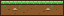

You start from the platformer you already saved. You change the log so the player can jump up through it from underneath and land on top, put a second log high above the top ground, and make the block slide left and right like a moving platform the player can ride. No new drawing and no new events. These steps are for Construct 3 in the browser ([editor.construct.net](https://editor.construct.net/)).

- **Learning objective:** We are learning to use behaviours to change how platforms act: one you can jump through from below, and one that moves.
- **Prior knowledge:** [Construct 3 Lesson 2: Face the Way You Run](../face-the-way-you-run/) (opening a saved project, adding a behaviour, Save as). Your saved platformer from [Lesson 1: Jump and Fall with Outside Assets](../platformer-outside-assets/) or Lesson 2 works. It needs a **Player**, a **ground**, a **log** and a **block**.
- **File you need:** your saved platformer (cloud save or the .c3p file you downloaded). Nothing new to download.
- **Time:** about half a class period.

### Success criteria

- I can open my saved platformer in Construct 3.
- I can give a platform the Jump-thru behaviour so the player jumps up through it and lands on top.
- I can make a platform slide back and forth with the Sine behaviour and ride it.
- I can save my game as a new file and hand it in.

### Key vocabulary

| Word | Meaning |
| --- | --- |
| **Jump-thru** | A behaviour that makes a platform solid only from above. The player passes up through it from below and stands on top. |
| **Sine** | A behaviour that moves an object back and forth smoothly, over and over, with no events. |
| **Magnitude** | How far Sine moves the object each way from where you placed it, in pixels. |
| **Period** | How many seconds one full trip there and back takes. A smaller number is faster. |

### Asset library

Missing a picture from Piskel? Use these examples. Click a file name to download it, then drag it in the way you did in Lesson 1.

| Picture | File | What it is | From |
| --- | --- | --- | --- |
|  | [ground.png](../../piskel/lesson-00-three-platforms/img/ground.png) | Ground platform, 64 × 16 | [Piskel Lesson 0: Three Platforms](../../piskel/lesson-00-three-platforms/) |
|  | [log.png](../../piskel/lesson-00-three-platforms/img/log.png) | Log platform, 48 × 16 | [Piskel Lesson 0: Three Platforms](../../piskel/lesson-00-three-platforms/) |
|  | [block.png](../../piskel/lesson-00-three-platforms/img/block.png) | Stone block, 16 × 16 | [Piskel Lesson 0: Three Platforms](../../piskel/lesson-00-three-platforms/) |
|  | [alien.png](../../piskel/lesson-00-jumping-alien/img/finished-sprite-sheet.png) | Jumping Alien, 5 poses (160 × 32) | [Piskel Lesson 1: Jumping Alien Sprite](../../piskel/lesson-00-jumping-alien/) |
|  | [runner.png](../../piskel/lesson-02-side-view-runner/img/runner-sheet.png) | Side-view runner, 2 frames (64 × 32) | [Piskel Lesson 2: Side-View Runner](../../piskel/lesson-02-side-view-runner/) |

No saved platformer at all? Do [Lesson 1: Jump and Fall with Outside Assets](../platformer-outside-assets/) Parts 1 to 4 first, using these files.

### Where things are

| Thing | Where on the screen |
| --- | --- |
| **Layout 1** and **Event sheet 1** tabs | Along the top of the middle area |
| **Properties Bar** | Left side panel. Shows the settings of whatever you clicked. |
| **Project Bar** (**Object types**) | Top-right panel |
| **Behaviors** link | Properties Bar, **Behaviors** group, beside **Add / edit** |
| **Preview** (▶ play button) | Main toolbar, top of the window (Shortcut: F5) |

If a bar is missing, open **Menu → View** and tick it.

```brief
Part 1 · Open your platformer
1 · Open | Menu → Project → Open | Your Lesson 1 or 2 platformer | Preview still works
Part 2 · Jump up through a log
2A · Jump-thru | log → Behaviors | Remove Solid · Add Jump-thru (Attributes)
2B · High log | Drag log from Object types | Position 960, 252 · Size 192, 64
2C · Test | Climb to the top ground | Jump straight up: through the log, land on top
Part 3 · A moving block
3A · Sine | block → Behaviors → Add Sine (Movements) | Movement Horizontal · Wave Sine | Period 4 · Magnitude 40
3B · Ride it | Preview · land on the block | It slides 40 px each way and carries you
Part 4 · Save as a new game
4 · Save as | Menu → Project → Save as | New name · Download a copy → Google Classroom
Extra · Finished early? (optional)
Drop down | Keyboard Down is down | Player → Platform → Fall through
Faster ride | block Sine Period 2
```

## Part 1 · Open your platformer

You don't start from scratch. You open the platformer you already built and saved.

1. Go to [editor.construct.net](https://editor.construct.net/). If you used a cloud save, log in first.
2. Choose **Menu → Project → Open**, then pick where your project is: your cloud save, or the .c3p file you downloaded (check your Downloads folder). Your platformer opens on the **Layout 1** tab (middle of the screen), with the player, the ground, the log and the block.
3. Look in the **Project Bar** (top-right panel) under **Object types**. You should see **Player**, **ground**, **log** and **block**.
4. Click **Preview** (the ▶ play button at the top). The player still runs, jumps and lands. Close the preview tab.

- [ ] Your platformer is open, with the player, ground, log and block on the layout
- [ ] **Object types** lists Player, ground, log and block
- [ ] Preview still works

## Part 2 · Jump up through a log

Right now every platform is **Solid**: the player bumps its head on the underside. In this part the log becomes **Jump-thru**, so the player can jump up through it from below and land on top. Then you put a second log high over the top ground, where you can only reach it by jumping up through it.

### 2A · Solid becomes Jump-thru

| log behaviours | Before | After |
| --- | --- | --- |
| Solid | On | Removed |
| Jump-thru | — | Added (in the **Attributes** group) |

Quick notes: one platform gets **either** Solid **or** Jump-thru, never both. Behaviours belong to the object type, so every log changes at once.

1. On the **Layout 1** tab, click the **log** once. The Properties Bar (left side panel) shows the log's settings. Check the top of the Properties Bar says **log**, not ground or block.
2. In the Properties Bar, scroll down to the **Behaviors** group and click the blue **Behaviors** link beside **Add / edit**. A window opens. Its title must read **log behaviors**, and it lists **Solid**.

@figure ../../assets/construct3/properties-behaviors.png The Properties Bar's Behaviors group. The blue Behaviors link beside Add / edit opens the behaviours window.

3. Right-click **Solid** in the list and choose **Delete**. Solid disappears from the list.
4. Click **Add new behavior**. In the **Attributes** group, click **Jump-thru** (or type **Jump** in the **Search** box at the top-right). Click **Add**. The **log behaviors** window now lists **JumpThru** and no Solid.
5. Close the window with its **X**.
6. Preview. Jump onto the log from the first ground the way you always have. You still land on it and stand on it, because Jump-thru is solid from above.

> **Pick the right one:** remove **Solid** before you test. If the log has both, Solid wins and the player still bumps its head from underneath.

### 2B · A second log up high

| Object | Position X, Y | Size W × H |
| --- | --- | --- |
| log (second) | 960, 252 | 192, 64 |

Quick notes: X 960 is right above the top ground. Y 252 puts the log 128 pixels above the ground's top, inside the player's jump of about 140, so you can just reach it.

1. In the **Project Bar** (top-right panel), drag **log** from **Object types** onto the layout. A second log appears.
2. With it still selected, type **Position 960, 252** and **Size 192, 64** in the Properties Bar (left side panel). If Position or Size shows as one line, click the small **▶** arrow beside it to open the boxes. The log now floats right above the top ground, with a gap underneath it about as tall as the player.

> **Pick the right one:** drag **log** from Object types, not log.png from your Downloads. log.png makes a new object type called **log2**, which has Solid and none of the log's new Jump-thru.

### 2C · Test it

1. Preview. Climb up to the top ground: the first ground, the log, the block, then the top ground.
2. Walk under the high log and press the **Up arrow**. The player jumps straight up **through** the log and lands **on top** of it.
3. Walk off the end of the high log. The player drops back down to the top ground.

- [ ] The log behaviors window lists Jump-thru and no Solid
- [ ] A second log floats above the top ground
- [ ] In Preview, jumping from underneath goes up through the log and lands on top

## Part 3 · A moving block

The **Sine** behaviour slides the block left and right on its own, forever, with no events. The block keeps its **Solid**, so the player can stand on it, and the **Platform** behaviour carries the player along while it moves.

### 3A · Add Sine to the block

| block → Sine | Value |
| --- | --- |
| Movement | Horizontal |
| Wave | Sine |
| Period | 4 |
| Magnitude | 40 |
| Enabled | On (ticked) |

Leave the other Sine settings as they are.

Quick notes: the block slides 40 pixels each way from where you placed it (700), so from X 660 to X 740 and back, once every 4 seconds. That keeps both jumps, from the log and onto the top ground, short enough to make.

1. On the **Layout 1** tab, click the **block** once. Check the top of the Properties Bar says **block**.
2. Click the blue **Behaviors** link (Properties Bar, Behaviors group). The window title must read **block behaviors**, and it lists **Solid**. Leave Solid there.
3. Click **Add new behavior**. In the **Movements** group, click **Sine**, the wavy line at the bottom beside **Rotate**. Under the list, the description starts with **Sine:**. Click **Add**.

@figure ../../assets/construct3/add-behavior-platform.png The Add behavior window's Movements group. Sine is the wavy line on the bottom row, beside Rotate. (Platform is highlighted here from Lesson 1; you click Sine.)

4. The **block behaviors** window now lists **Solid** and **Sine**. Close it with its **X**.
5. In the Properties Bar, find the new **Sine** settings under **Behaviors**. Check **Movement** is **Horizontal** and **Wave** is **Sine**. Type **4** in **Period** and **40** in **Magnitude**, pressing **Enter** after each.

> **Pick the right one:** Sine goes on the **block**, not the player. On the player it would shove the character left and right on its own.

### 3B · Ride it

1. Preview. The block slides smoothly left and right, slowing down at each end, then coming back.
2. Climb onto the log, wait for the block to come close, and jump onto it. Stand still. The block carries the player left and right.
3. When the block slides toward the top ground, jump across.

> **Test tip:** time your jump. The jump from the log is shortest when the block slides left, toward the log. The jump to the top ground is shortest when it slides right.

- [ ] block behaviors lists Solid and Sine
- [ ] In Preview, the block slides left and right by itself
- [ ] Standing still on the block, the player rides along with it

## Part 4 · Save as a new game

Use **Save as**, not Save, so your earlier game stays as it was and this becomes a new game.

1. Choose **Menu → Project → Save as** and give it a new name, for example `Platformer jump-thru yourname`.
   - **Logged in:** choose **Cloud save**. After that, the Save button (disk icon) saves to the same place. (Shortcut: Ctrl+S)
   - **Guest:** choose **Download a copy** before you close the tab.
2. **To hand in:** **Menu → Project → Save as → Download a copy** and upload the .c3p file to [Google Classroom](https://classroom.google.com/).

- [ ] The game is saved with a new name
- [ ] The .c3p file is uploaded to Google Classroom

## Extra · Finished early?

Optional. Try one or both, then Save again.

| Event | Condition | Action |
| --- | --- | --- |
| New | Keyboard → Key is down → Down arrow | Player → Platform → Fall through |

1. **Drop down through a log:** on the **Event sheet 1** tab, click **Add event** at the bottom of the sheet → **Keyboard** → **Key is down**. Click the key box, press the **Down arrow**, and click **Done**. Then click the grey **Add action** on that row → **Player** → **Fall through** (in the **Platform** group) → **Done**. Preview, stand on a log and press the Down arrow: the player drops through it. On the ground or the block nothing happens, because they're Solid.
   - No **Keyboard** in the Add condition list? Your game came from Lesson 1. Insert it first: double-click an empty part of the layout, click **Keyboard**, click **Insert**, as in [Lesson 2, Part 3A](../face-the-way-you-run/).
2. **Faster ride:** click the block and change its Sine **Period** from 4 to **2**. Preview. The block slides twice as fast, so the timing is harder.

## Troubleshooting

| Problem | Fix |
| --- | --- |
| The player still bumps its head under the log | The log still has **Solid**. Open **log behaviors** and delete Solid (2A). |
| The player falls through the log from above too | The log has no behaviour at all. Add **Jump-thru** (2A). |
| The project now has **log2** | You dragged log.png in again. Delete log2 from the layout and drag **log** from Object types instead (2B). |
| You can't reach the high log | Check its Position is **960, 252** and jump from directly underneath it. |
| The block doesn't move | Sine is on the wrong object, or **Enabled** is unticked. Click the block and check its Behaviors (3A). |
| The player slides off the moving block, or the player moves by itself | Sine went on the player. Open **Player behaviors**, delete Sine, and add it to the block. |
| The block moves up and down | **Movement** is set to Vertical. Change it to **Horizontal**. |
| The jump from the block is too far | **Magnitude** is too big. Set it back to **40**. |
