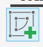
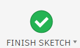
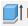
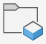
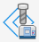
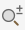
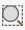

You turn an outline picture (a polar bear in the video) into an SVG file, put it on top of a wooden block in Fusion, and program an **Engrave** toolpath that a V-shaped bit follows. You simulate the cut and hand in a screenshot. These steps are for the current version of Autodesk Fusion on Windows 11. Every part has a ▶ link that jumps the video to that step.

- **Learning objective:** We are learning to turn a picture into vector lines and program an engraving toolpath from them.
- **Prior knowledge:** [Groove Block 2: Toolpath and Post](../lesson-01-groove-block-toolpath/) (you bring making a Setup, picking a tool and running Simulate). Sketching, Center Rectangle and Extrude come from [Groove Block 1: Make the Object](../lesson-00-groove-block/).
- **File you need:** a simple black-on-white outline picture. Use a royalty-free one (the video uses royalty-free clip art from [iStock](https://www.istockphoto.com/)).
- **Time:** about one class period

### Success criteria

- I can turn a PNG picture into an SVG file.
- I can model a block in inches and put an SVG on its top face.
- I can set up stock, a work zero and a sharp engraving tool.
- I can select the picture's lines and program an Engrave toolpath to stock top.
- I can simulate the engraving and explain why wide lines cut deeper.

### Key vocabulary

| Word | Meaning |
| --- | --- |
| **PNG** | A picture file made of pixels (tiny coloured squares). It goes blocky when you make it bigger. |
| **SVG** (scalable vector graphic) | A picture file made of lines and curves, so it stays sharp at any size. Fusion can use its lines as sketch geometry. Remember it as "super very good". |
| **File converter** | A website or program that changes a file from one type to another, such as PNG to SVG. |
| **Setup** | The CAM settings for stock, work zero and which way is up. |
| **Engrave** | A toolpath where a V-shaped bit follows the middle of the lines. Wider spaces between lines make it go deeper. |
| **V-bit** (engraving tool) | A cutter with a pointed, cone-shaped tip. The 45° in its name is the angle of the cone. |
| **Tip diameter** | The width of the flat at the very point of a V-bit. Smaller means sharper. |

| Colour | Meaning |
| --- | --- |
| Green | Safe to change. No real effect on the cut. |
| Amber | Changes how deep or how hard the tool cuts. Fine at the values given. |
| Red | Use with caution. A wrong value can break the bit or wreck the part. |

The **Bottom height** in 4B (how deep the engraving goes) is amber. The **work zero** and **stock** in 3A are red: if they are wrong on a real machine, the bit cuts in the wrong place or at the wrong depth. This lesson only simulates, so nothing here can harm a machine.

### Where things are

| Thing | Where on the screen |
| --- | --- |
| **Snipping Tool** | Windows 11: Start menu, type **Snipping Tool**. (Shortcut: Windows key + Shift + S) |
| **Workspace switcher** (DESIGN / MANUFACTURE) | Fusion: far left of the toolbar, top-left |
| **Save**  | Fusion: top-left bar, just right of the File menu |
| **Create Sketch**  | Fusion: toolbar, left end of the SOLID tab |
| **SKETCH** tab | Fusion: toolbar, opens on its own while you sketch. CREATE ▾ → Rectangle → Center Rectangle  |
| **Finish Sketch**  | Fusion: green tick at the right end of the SKETCH tab |
| **Extrude**  | Fusion: SOLID tab, CREATE ▾ menu (Shortcut: E) |
| **INSERT ▾** menu | Fusion: SOLID tab, near the right end of the toolbar. Has **Insert SVG** |
| **Browser** | Fusion: left side, under the toolbar. Document Settings, bodies, sketches, Setups |
| **MILLING** tab (MANUFACTURE) | Fusion: toolbar after switching to MANUFACTURE. **SETUP** group: New Setup  · **2D** group: Engrave · **ACTIONS** group: Simulate  |
| **ViewCube** and **Home**  | Fusion: top-right corner of the canvas. The Home button shows only when the mouse is near the ViewCube |
| **Navigation bar**: Orbit  · Pan  · Zoom  · Fit  | Fusion: bottom centre of the canvas, just above the Timeline |

A folded item in the **Browser** opens with the small **›** arrow on its left. If a toolpath dialog seems to be missing, it opens on the right side of the canvas.

```brief
Part 1 · Prepare the picture
1A · Snip it | Search "polar bear outline" (royalty-free) | Snipping Tool → New → drag a box | [▶ 0:00](https://youtu.be/1fuxBlkcKwc?t=0)
1B · Save PNG | Save As → Desktop · polar bear.png | [▶ 0:50](https://youtu.be/1fuxBlkcKwc?t=50)
1C · Convert | convertio.co · Choose Files · to SVG · Convert | [▶ 1:06](https://youtu.be/1fuxBlkcKwc?t=66)
1D · Download | Download → Show in folder | Copy to Desktop · polar bear.svg | [▶ 1:56](https://youtu.be/1fuxBlkcKwc?t=116)
Part 2 · The block and the SVG
2A · Inch design | + new tab · Document Settings → Units: in | Not as default | [▶ 2:57](https://youtu.be/1fuxBlkcKwc?t=177)
2B · Sketch | XY plane · Center Rectangle on origin | 5.75 · Tab · 7 | [▶ 3:13](https://youtu.be/1fuxBlkcKwc?t=193)
2C · Extrude | Finish Sketch · Extrude 0.75 in | [▶ 4:18](https://youtu.be/1fuxBlkcKwc?t=258)
2D · Insert SVG | INSERT ▾ → Insert SVG · top face | Flip if upside down · fit inside top | [▶ 4:42](https://youtu.be/1fuxBlkcKwc?t=282)
2E · Save | Finish Sketch · Save: polar bear | [▶ 5:44](https://youtu.be/1fuxBlkcKwc?t=344)
Part 3 · Setup and tool
3A · Setup | MANUFACTURE · New Setup | Origin: stock box point, top centre | Stock: No additional stock | [▶ 6:09](https://youtu.be/1fuxBlkcKwc?t=369)
3B · Engrave tool | 2D → Engrave · Tool → Select | Tutorial tools · inch · 45° engrave | [▶ 7:40](https://youtu.be/1fuxBlkcKwc?t=460)
3C · Sharpen it | Right-click tool → Edit tool | Tip diameter 0.005 in · Accept | [▶ 8:05](https://youtu.be/1fuxBlkcKwc?t=485)
Part 4 · Toolpath and simulate
4A · Geometry | Geometry tab · Contours: click the bear's lines | [▶ 9:25](https://youtu.be/1fuxBlkcKwc?t=565)
4B · Heights | Top height: Stock top | Bottom height: Stock top −2 mm (amber) | [▶ 9:52](https://youtu.be/1fuxBlkcKwc?t=592)
4C · Simulate | ACTIONS → Simulate · Stock on · Play | [▶ 10:47](https://youtu.be/1fuxBlkcKwc?t=647)
4D · All the lines | Right-click Engrave1 → Edit | Select every contour · OK · green tick | [▶ 11:26](https://youtu.be/1fuxBlkcKwc?t=686)
Part 5 · Check and hand in
5A · Simulate again | Slow it down · watch it cut | Wide gaps = deeper cut | [▶ 12:04](https://youtu.be/1fuxBlkcKwc?t=724)
5B · Hand in | Top view · screenshot · submit | [▶ 13:02](https://youtu.be/1fuxBlkcKwc?t=782)
Extra · Finished early? (optional)
Try a 90° bit | Copy Engrave1 · 90° engrave tool · tip 0.005 | Compare the two screenshots
```

## Part 1 · Prepare the picture

[▶ Watch this part (0:00)](https://youtu.be/1fuxBlkcKwc?t=0)

Fusion can't use a PNG picture for engraving: it needs lines. In this part you grab a picture as a PNG and convert it to an SVG, which is made of lines.

### 1A · Find a picture and snip it

[▶ Watch (0:00)](https://youtu.be/1fuxBlkcKwc?t=0)

| Picture | Why |
| --- | --- |
| Black outline on a white background | Clean lines convert into clean SVG lines |
| Royalty-free (free to use) | You are allowed to use it in your work |
| Simple: not many tiny details | Tiny details turn into lines too close together to engrave |

1. Open a web browser and search for your picture with the word **outline**, for example **polar bear outline**. Pick a picture marked **royalty-free**.
2. Open the **Snipping Tool** (Start menu, type **Snipping Tool**). Its small window opens.
3. Click **New**. The screen goes grey.
4. Drag a box around the picture. Let go of the mouse. The snip opens in the Snipping Tool window.

### 1B · Save it as a PNG

[▶ Watch (0:50)](https://youtu.be/1fuxBlkcKwc?t=50)

1. In the Snipping Tool window, click **Save as** (the floppy disk button, or **…** → **Save as**). The **Save As** box opens.
2. Click **Desktop** on the left. Name the file **polar bear** (or your picture's name). Check **Save as type** says **PNG**. Click **Save**.

### 1C · Convert the PNG to SVG

[▶ Watch (1:06)](https://youtu.be/1fuxBlkcKwc?t=66)

1. In the browser, go to [Convertio: PNG to SVG](https://convertio.co/png-svg/). Any other PNG-to-SVG converter works too.
2. Click **Choose Files**. Click **Desktop**, click **polar bear**, then **Open**. The file shows in a list.
3. Check the box beside it says **SVG**. If it doesn't, click the box, then **Image**, then **SVG**.
4. Click **Convert**. A progress bar runs. It can take a little while. When it is done, a blue **Download** button appears.

### 1D · Download it and put it on the Desktop

[▶ Watch (1:56)](https://youtu.be/1fuxBlkcKwc?t=116)

1. Click **Download**. A downloads box opens near the top-right of the browser.
2. Find the polar bear file in the box and click the **folder** button (**Show in folder**). File Explorer opens with the SVG selected. Windows may call it **Microsoft Edge HTML Document**: that is normal, it is still the SVG.
3. Right-click the file and choose **Copy**. Right-click an empty spot on the **Desktop** and choose **Paste**. You now have two polar bear files on the Desktop: the PNG and the SVG.

- [ ] **polar bear.png** is on my Desktop
- [ ] **polar bear.svg** is on my Desktop too

## Part 2 · The block and the SVG

[▶ Watch this part (2:57)](https://youtu.be/1fuxBlkcKwc?t=177)

### 2A · A new design in inches

[▶ Watch (2:57)](https://youtu.be/1fuxBlkcKwc?t=177)

| Setting | Value |
| --- | --- |
| Units | Inch |
| Set as default | Off (this design only) |

1. Open Fusion. Click the **+** at the right end of the tabs along the top. A new **Untitled** design opens.
2. In the **Browser** (left side), click the small **›** arrow beside **Document Settings**. **Units** shows under it.
3. Point at **Units** and click the small pencil button that appears (**Change Active Units**). The **Change Active Units** box opens on the right.
4. Set **Unit Type** to **Inch**. Leave **Set as Default** unticked. Click **OK**. The line in the Browser now reads **Units: in**.

### 2B · Sketch the block

[▶ Watch (3:13)](https://youtu.be/1fuxBlkcKwc?t=193)

| Setting | Value |
| --- | --- |
| Plane | XY (lying flat) |
| Rectangle | Center Rectangle, centre on the origin, 5.75 × 7 in |

1. On the toolbar, click **Create Sketch**  (left end of the **SOLID** tab). The three origin planes appear.
2. Click the **XY** plane: the square lying flat on the grid. The view turns to look straight down on it and the toolbar switches to the **SKETCH** tab.
3. Open the **CREATE ▾** menu and choose **Rectangle → Center Rectangle** .
4. Click the **origin** (the dot where the red and green axes cross). Move the mouse up and to the right. Two dimension boxes appear.
5. Take your hand off the mouse. Type **5.75** in the highlighted box, press **Tab**, type **7** in the other box and press **Enter**. A 5.75 × 7 in rectangle appears with the origin in its middle.

**Quick notes:** This is the area for the artwork. In the video the sketch also starts a bigger 18 × 9 in board for a beading project; this lesson makes only the artwork block.

### 2C · Extrude the block

[▶ Watch (4:18)](https://youtu.be/1fuxBlkcKwc?t=258)

| Setting | Value |
| --- | --- |
| Distance | 0.75 in (3/4 in) |

1. Click **Finish Sketch** , the green tick at the right end of the **SKETCH** tab. The toolbar goes back to **SOLID**.
2. Click **Home**  (beside the ViewCube, top-right) so you can see the rectangle at an angle.
3. Open **CREATE ▾** and choose **Extrude** . Click inside the rectangle. It turns blue.
4. In the **Extrude** box (right side), type **0.75** for **Distance**. The block rises. Click **OK**. A 5.75 × 7 × 0.75 in block sits on the grid.

### 2D · Insert the SVG on the top face

[▶ Watch (4:42)](https://youtu.be/1fuxBlkcKwc?t=282)

| Insert SVG | Value |
| --- | --- |
| File | polar bear.svg (Desktop) |
| Sketch plane | Top face of the block |
| Size and place | Whole picture inside the top face, about 1/2 in from every edge |
| Upside down? | Use the flip button |

1. On the **SOLID** tab, open **INSERT ▾** and choose **Insert SVG**. The **Insert SVG** box opens on the right.
2. Click **Select** (the plane) and click the **top face** of the block. It turns blue.
3. Click the **folder** button beside **SVG File**. Click **Desktop** and pick **polar bear**: the one whose type says **SVG**. Click **Open**. The bear appears on the top face, with move, turn and size handles on it.
4. The bear often comes in upside down and too big. Use the handles:
   - the **arrows** slide it left and right, or forward and back
   - the **half-moon** handle makes it bigger or smaller
   - the **flip** buttons turn it over the right way up
   - the **round** handle turns it to an angle
   You can also type values in the **Insert SVG** box instead of dragging.
5. Get the whole bear inside the top face, with about 1/2 in to spare on every side. It does not have to be perfect. Point at the bear: it turns green.
6. Click **OK**. The bear's lines become a new sketch on the top face.

### 2E · Finish the sketch and save

[▶ Watch (5:44)](https://youtu.be/1fuxBlkcKwc?t=344)

1. If the toolbar is still on the **SKETCH** tab, click **Finish Sketch** .
2. Click **Save**  (top-left bar). Choose your class folder, name the design **polar bear yourname** and click **Save**. The tab name changes.

- [ ] A 5.75 × 7 × 0.75 in block sits on the grid, centred on the origin
- [ ] The bear's lines sit on the top face, the right way up and inside the edges
- [ ] The tab shows my design's name, not Untitled

## Part 3 · Setup and tool

[▶ Watch this part (6:09)](https://youtu.be/1fuxBlkcKwc?t=369)

### 3A · The Setup: stock and work zero

[▶ Watch (6:09)](https://youtu.be/1fuxBlkcKwc?t=369)

| Setup setting | Value |
| --- | --- |
| Operation Type | Milling |
| Origin (red) | Stock box point: top centre |
| Stock (red) | Relative size box, Stock Offset Mode: No additional stock |

1. Click the **DESIGN ▾** box (far left of the toolbar) and choose **MANUFACTURE**. The toolbar changes to the **MILLING** tab.
2. Under **SETUP**, click **New Setup** . The **Setup** box opens and an orange box (the stock) appears around the block.
3. Orbit around the block. The orange stock is a little bigger than the block: Fusion adds 1 mm on the top and sides.
4. Set **Origin** to **Stock box point**. Small dots appear on the stock box. Click the dot in the **centre of the top face**. The WCS arrows jump there.
5. Click the **Stock** tab. Set **Stock Offset Mode** to **No additional stock**. The orange box shrinks onto the block.
6. Click **OK**. **Setup1** appears in the Browser.

**Quick notes:** If you make lots of setups, the **⋮** (three dots) beside the **Stock** settings has **Save as default**, so you don't have to remove the extra stock every time. It is still good practice to check it each time. In the video the origin stays at the design origin; top centre is used here because that is where you set zero on the real CNC.

### 3B · Start an Engrave and pick a tool

[▶ Watch (7:40)](https://youtu.be/1fuxBlkcKwc?t=460)

| Tool | Value |
| --- | --- |
| Library | Fusion Library → Tutorial tools (inch) |
| Type | Engrave (V-bit), 45° |

1. Under **2D** on the toolbar, open the **2D ▾** list and choose **Engrave**. The **Engrave** box opens on its **Tool** tab.
2. Click **Select** beside **Tool**. The tool library opens.
3. On the left, open **Fusion Library** and click the **Tutorial** tools in **inches**.
4. Find the **45°** engrave tool (a cone-shaped tip) and double-click it. The library closes and the tool shows on the Tool tab.

### 3C · Make the tip sharp

[▶ Watch (8:05)](https://youtu.be/1fuxBlkcKwc?t=485)

| Cutter setting | Value |
| --- | --- |
| Tip diameter | 0.005 in (about as pointy as a pin) |
| Everything else | Leave as it is |

1. Right-click the tool on the **Tool** tab and choose **Edit tool**. The tool window opens on the **Cutter** tab. Look at the picture: the tip has a flat, blunt end.
2. Click in the **Tip diameter** box and type **0.005**. Make sure you are in the **tip diameter** box: typing a size into the **taper angle** box gives a "cannot convert from degrees" message.
3. The picture now shows a sharp point. Leave the shaft diameter and the cutting data as they are (the feed is about 40 in/min, which doesn't matter for a simulation). Click **Accept**.

- [ ] **Setup1** shows the WCS arrows in the middle of the top of the block
- [ ] The Engrave box shows a 45° engrave tool with a sharp tip

## Part 4 · Toolpath and simulate

[▶ Watch this part (9:18)](https://youtu.be/1fuxBlkcKwc?t=558)

### 4A · Select the bear's lines

[▶ Watch (9:25)](https://youtu.be/1fuxBlkcKwc?t=565)

1. In the **Engrave** box, click the **Geometry** tab (the second tab). **Contours** is waiting for you to pick lines.
2. Click a few of the bear's lines. Each one turns blue. Start with a few: you add the rest in 4D.

### 4B · Heights: engrave down from the top of the stock

[▶ Watch (9:52)](https://youtu.be/1fuxBlkcKwc?t=592)

| Height | From | Offset |
| --- | --- | --- |
| Top Height | Stock top | 0 |
| Bottom Height (amber) | Stock top | −2 mm (−0.079 in) |
| Retract Height, Feed Height | Leave as they are | |

1. Click the **Heights** tab (the third tab). It shows the heights the tool travels at: **Retract** (how high it lifts between cuts), **Feed** (where it slows down to cut), **Top** and **Bottom**.
2. Set **Top Height** to **Stock top**.
3. Set **Bottom Height** to **Stock top** and type **−2 mm** in its **Offset** box. Fusion changes it to inches. This is the deepest the bit can go.
4. Click **OK**. Fusion calculates and lines appear on the bear. **Engrave1** appears under Setup1 in the Browser.

### 4C · Simulate

[▶ Watch (10:47)](https://youtu.be/1fuxBlkcKwc?t=647)

1. Click **Setup1** in the Browser. Under **ACTIONS**, click **Simulate** . The **Simulate** box opens.
2. Make sure **Stock** is ticked, so you see the wood being cut.
3. Press **Play** along the bottom. The bit cuts along the lines you picked. Zoom in to look.
4. Click **Close** to leave the simulation.

### 4D · Add all the lines

[▶ Watch (11:26)](https://youtu.be/1fuxBlkcKwc?t=686)

1. In the Browser, right-click **Engrave1** and choose **Edit**. The Engrave box opens again.
2. Click the **Geometry** tab. Zoom in and click every line of the bear you haven't picked. If you click one by mistake, click it again to unselect it.
3. Click **OK**. Fusion calculates again. A **green tick** beside **Engrave1** in the Browser means the toolpath worked.

- [ ] **Engrave1** has a green tick in the Browser
- [ ] The toolpath lines follow every part of the bear

## Part 5 · Check and hand in

[▶ Watch this part (12:04)](https://youtu.be/1fuxBlkcKwc?t=724)

### 5A · Simulate again

[▶ Watch (12:04)](https://youtu.be/1fuxBlkcKwc?t=724)

1. Click **Setup1**, then **Simulate** . Drag the speed slider down a bit and press **Play**.
2. Watch where it goes deeper. Where the bear's lines are thick, or far apart, the V-bit goes deeper to fill the gap. Thin lines get a shallow cut. It is like pressing harder or lighter with a pen. The −2 mm is only the deepest it can go.
3. Use the buttons along the bottom to speed it up, slow it down or play it backwards.

### 5B · Screenshot and hand in

[▶ Watch (13:02)](https://youtu.be/1fuxBlkcKwc?t=782)

1. When the simulation is finished, click **TOP** on the ViewCube so you look straight down on the bear.
2. Take a screenshot with the **Snipping Tool** (as in 1A) and save it as **polar bear yourname.png**.
3. Hand in the screenshot. (A screen recording of the toolpath playing is fine too.)
4. Click **Close**, then **Save** .

**On a real piece:** paint the wood first, then engrave it. The cut lines show the bare wood, a different colour from the paint, so the bear stands out.

- [ ] My screenshot shows the whole bear engraved, seen from the top
- [ ] I can say why some lines are deeper than others

## Extra · Finished early?

Optional.

- **Try a 90° bit:** in the Browser, right-click **Engrave1** → **Duplicate**. Edit the copy, pick a **90°** engrave tool from the Tutorial tools, set its tip diameter to **0.005 in** and click **OK**. Simulate each one (right-click it → Simulate) and screenshot both. Which one makes wider lines? Why?

## Troubleshooting

| Problem | Fix |
| --- | --- |
| Insert SVG shows nothing, or Fusion won't open the file | You picked the PNG. Pick the file whose type says SVG (it may say Microsoft Edge HTML Document). |
| The SVG is a solid shape or a messy blob | Use a picture with clean black outlines on white, then convert again. |
| The bear hangs off the edge of the block | Right-click the SVG sketch in the Browser → Edit Sketch, or undo and insert it again smaller. |
| "Cannot convert from degrees" when editing the tool | You typed into the taper angle box. Type 0.005 in the **Tip diameter** box. |
| Simulation cuts only part of the bear | Edit Engrave1 and select the rest of the lines on the Geometry tab (4D). |
| You can't see any cut in Simulate | Tick **Stock** in the Simulate box. |
| The engraving looks too deep or floats above the wood | Check Top and Bottom Height both say **Stock top**, and the stock is set to **No additional stock**. |

## Video chapters

Copy this list into the YouTube description to add chapters to the video.

```
0:00 Find a royalty-free outline picture
0:26 Snip it and save as a PNG
1:06 Convert the PNG to SVG with Convertio
1:56 Download and copy the SVG
2:57 New design in inches
3:13 Sketch a centre rectangle
4:18 Extrude it 3/4 inch
4:42 Insert the SVG
5:44 Finish the sketch and save
6:09 Manufacture: new setup
6:34 Stock with no extra material
7:40 Choose an engraving tool
8:05 Sharpen the tool tip
9:18 Select the geometry
9:52 Heights: top of stock, 2 mm deep
10:47 Simulate the cut
11:26 Select all the geometry
12:04 Simulate again
12:39 Why wide lines cut deeper
13:02 Screenshot for the assignment
13:36 Inspect, then paint and cut
```
