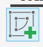
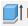
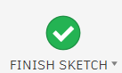
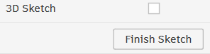
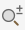
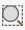

You model a 4 × 3 × 1 in block with a rounded-rectangle groove on top. This is the part you will program in the next lesson and cut on the Nomad 3 after that. These steps are for the current version of Autodesk Fusion.

- **Learning objective:** We are learning to model a part from exact sizes with sketches, fillets, offsets and extrudes.
- **Prior knowledge:** Basic Fusion navigation (orbit, pan and zoom). This is the first Fusion lesson.
- **Time:** about one class period

**The Groove Block series:** 1 Make the object (this lesson) · [2 Toolpath and post](../lesson-01-groove-block-toolpath/) · [3 Set up the Nomad and run the part](../../nomad/lesson-00-groove-block-run/)

### The part

| Feature | Size |
| --- | --- |
| Block (X × Y × Z) | 4 in × 3 in × 1 in |
| Groove outer edge | 3 in × 2 in rectangle, centred, 0.5 in from every side |
| Groove outer corner fillets | 0.5 in |
| Groove width | 1/2 in (0.5 in), twice the cutter |
| Middle island | 2 in × 1 in, square corners (these come from the offset) |
| Groove depth | 1/16 in (0.0625 in) |

**Quick notes:** The groove is twice as wide as the 1/4 in end mill used in the next lessons, so the toolpath has room to move. The island's corners come out square because 0.5 in − 0.5 in = 0, and the cutter can cut those outside corners sharp.

### Success criteria

- I can start a design in inches and model a block centred on the origin.
- I can sketch, fillet and offset a groove and cut it to an exact depth.

### Key vocabulary

| Word | Meaning |
| --- | --- |
| **Sketch** | A flat 2D drawing on a plane or face that 3D features are built from. |
| **Center Rectangle** | A rectangle drawn out from its middle point. |
| **Fillet** | A rounded corner of a set radius. |
| **Offset** | A copy of a shape a set distance inside or outside it. |
| **Profile** | A closed area of a sketch that can be extruded. |
| **Extrude** | Pull a profile up into a solid, or push it down to cut. |
| **Timeline** | The row of features along the bottom, in the order they were made. |

| Colour | Meaning |
| --- | --- |
| Green | Safe to change. No real effect on the cut. |
| Amber | Changes the load on the cutter and spindle. Fine at the values given. |
| Red | Use with caution. A wrong value can break the end mill or wreck the part. |

This lesson has no amber or red settings: nothing here can harm a machine. The sizes still matter, because the next lessons cut exactly what you model.

### Where things are

| Thing | Where on the screen |
| --- | --- |
| **Workspace switcher** (DESIGN / MANUFACTURE) | Fusion: far left of the toolbar, top-left |
| **Save**  | Fusion: top-left bar, just right of the File menu |
| **Create Sketch**  | Fusion: toolbar, left end of the SOLID tab |
| **Extrude**  | Fusion: SOLID tab, CREATE ▾ menu (Shortcut: E) |
| **SKETCH** tab | Fusion: toolbar, opens on its own while you sketch. CREATE ▾ (), MODIFY ( ) |
| **Finish Sketch**  | Fusion: green tick at the right end of the SKETCH tab |
| **Sketch Palette** | Fusion: right side, shows while you sketch. Its **Finish Sketch** button at the bottom  does the same job as the green tick |
| **Browser** | Fusion: left side, under the toolbar. Document Settings, bodies, sketches, Setups |
| **ViewCube** and **Home**  | Fusion: top-right corner of the canvas. The Home button shows only when the mouse is near the ViewCube |
| **Navigation bar**: Orbit  · Look At  · Pan  · Zoom  · Fit  | Fusion: bottom centre of the canvas, just above the Timeline |
| **Timeline** | Fusion: along the bottom. Every feature in order; double-click one to edit it |

A folded item in the **Browser** opens with the small **›** arrow on its left. Open, the arrow points down (**⌄**).

```brief
Part 1 · The block
1A · Inch design | File → New Design → Part Design | Unit System: inch (in), ouncemass
1B · Sketch the block | XY plane · Center Rectangle | Centre on the origin: 4 × 3
1C · Extrude 1 in | Home view (house by ViewCube) | Extrude · Distance 1 · OK
Part 2 · The groove
2A · Groove sketch | Top face · Center Rectangle 3 × 2 | Fillet 0.5 · Offset −0.5 inside
2B · Cut the groove | Extrude the ring −0.0625 | Operation Cut · Save
Extra · Finished early? (optional)
Chamfer | MODIFY ▾ → Chamfer · top outer edges 0.03 in | Then Suppress it on the Timeline
```

## Part 1 · The block

### 1A · Start a Part Design in inches

| Setting | Value |
| --- | --- |
| Design type | Part Design |
| Unit System | inch (in), ouncemass |
| Design name | Groove Block |

1. Open Fusion. Check that the **workspace switcher** (far left of the toolbar) says **DESIGN**.
2. Open the **File** menu and choose **New Design**. The **What do you want to design?** box opens.
3. Click **Part Design** (top-left card). It turns blue, and its settings show on the right.
4. Click the **Unit System** list and choose **inch (in), ouncemass**. A tick appears beside it.

@figure new-design-dialog.png The What do you want to design? box: Part Design picked, and the Unit System list open with inch (in), ouncemass ticked.

5. Click **Create New**. A new **Untitled** tab appears along the top.
6. In the **Browser** (left side), click the small **›** arrow beside **Document Settings**. The arrow turns to point down, and the line under it reads **Units: in, ouncemass**.

@figure browser-document-settings.png Document Settings open in the Browser. This one still says mm, g: if yours does too, see Troubleshooting.

7. Click **Save**  (top-left bar, just right of the File menu). Name the design **Groove Block** and click **Save**. The tab name changes to **Groove Block**.

### 1B · Sketch the block

| Setting | Value |
| --- | --- |
| Plane | XY (lying flat) |
| Rectangle | Center Rectangle, centre on the origin, 4 × 3 in |

1. On the toolbar, click **Create Sketch**  (at the left end of the **SOLID** tab). The three origin planes appear in the canvas.
2. Click the **XY** plane: the square lying flat on the grid, beside the red X and green Y axes. The blue Z axis points straight up. The view turns to look straight down on it.

@figure origin-planes.png The origin planes after clicking Create Sketch. The flat square on the grid is the XY plane. Blue Z points up, and the grid numbers (0.5, 1, 1.5, 2) are inches.

@figure ../../assets/fusion/viewcube-top.png After you click the XY plane, the ViewCube shows **TOP**: you are looking straight down, with Y (green) pointing up the screen and X (red) to the right.
3. The toolbar has switched to the **SKETCH** tab. Open its **CREATE ▾** menu and choose **Rectangle → Center Rectangle** .

@figure create-menu.png The CREATE menu on the SKETCH tab: Rectangle → Center Rectangle, the third choice.

4. Click on the **origin** (the dot where the red and green axes cross). This is the centre of the rectangle. Move the mouse up and to the right. Two dimension boxes appear: one along the **bottom** edge and one on the **left side**.

> **Take your hand off the mouse before you type.** If the mouse moves while you are typing, the rectangle changes and your numbers can be lost.
>
> **Tab** jumps back and forth between the two boxes. The number you type goes into the **highlighted** box, so check which one is highlighted before you type.

5. Type **4** into the **bottom** box. Press **Tab** to move to the **left side** box and type **3**. Press **Enter**. A 4 × 3 rectangle appears with the origin in its middle: 4 in wide (left to right) and 3 in deep (front to back).

@figure block-rectangle.png The finished Center Rectangle: 4.00 along the bottom, 3.00 on the left side. The dashed lines cross at the origin, so the rectangle is centred on it.
6. Click **Finish Sketch** , the green tick at the right end of the **SKETCH** tab. The **Sketch Palette** (right side) closes and the toolbar goes back to the **SOLID** tab.

@figure sketch-palette.png The Sketch Palette on the right while you sketch. Leave its options as they are. (Its Finish Sketch button at the bottom does the same job as the green tick.)

7. Look at the **Timeline** along the bottom. A sketch icon now sits beside the Play buttons.

@figure ../../assets/fusion/timeline.png The Timeline after the first sketch: the Play buttons on the left, then a sketch icon. Each new feature adds an icon to the right.

**Quick notes:** 4 in runs along X (red axis), 3 in along Y (green axis). The origin sits in the middle of the block, which is where work zero goes for the CNC program in Part 2.

### 1C · Extrude it 1 in tall

| Setting | Value |
| --- | --- |
| Distance | 1 in |
| Operation | New Body |

1. Move the mouse up to the **ViewCube** (top-right corner of the canvas). A small **Home**  button appears just above its top-left corner. It only shows while the mouse is in that area. Click it. The view turns to an angle, so the flat rectangle looks like a tile on the floor and the extrusion will make sense.

@figure ../../assets/fusion/viewcube.png The ViewCube, top-right of the canvas, with the Home button (the little house) above its top-left corner. Hover there to make the house appear.

2. On the **SOLID** tab, open the **CREATE ▾** menu and choose **Extrude** . (Shortcut: E) The **Extrude** box opens on the right.

@figure solid-create-menu.png The CREATE menu on the SOLID tab. Extrude is the fifth item, with the shortcut E beside it.
3. Click inside the rectangle. It turns blue and an arrow appears.
4. In **Distance**, type **1** and press **Enter**. The preview grows into a block 1 in tall.
5. Click **OK**. **Body1** appears in the Browser under **Bodies**. If the block is off screen, click **Fit**  on the navigation bar.

@figure block-extruded.png The finished block after 1C, seen from the Home view: 4 × 3 in, 1 in tall.

- [ ] The Browser shows **Units: in, ouncemass**
- [ ] One body, a 4 × 3 × 1 in block, centred on the origin
- [ ] The Timeline (bottom) shows Sketch, Extrude

## Part 2 · The groove

### 2A · Sketch the groove on the top face

| Setting | Value |
| --- | --- |
| Rectangle | Center Rectangle, centre on the origin, 3 in × 2 in |
| Sketch fillet (4 corners) | 0.5 in |
| Offset (inside) | −0.5 in |

1. Click **Create Sketch** , then click the **top face** of the block. The view turns to look straight down on it. If it doesn't, click **Look At**  on the navigation bar (bottom centre).
2. On the **SKETCH** tab, open **CREATE ▾** and choose **Rectangle → Center Rectangle** .
3. Click the **origin** dot in the middle of the top face. Move the mouse out toward a corner. Two dimension boxes appear, one along the bottom and one on the left side.
4. **Hand off the mouse.** Type **3** into the **bottom** box, press **Tab** to move to the **left side** box, and type **2**. Press **Enter**.

@figure groove-dimension-boxes.png Typing the groove size. After 3 and Tab, the bottom box shows **3 in** with a gold padlock (that size is locked in), and the left box is highlighted, ready for **2**. A 3 × 2 rectangle appears in the centre of the top face, 0.5 in in from every edge.
5. On the **SKETCH** tab, click **Fillet**  (the first button under **MODIFY**). Click the two lines that meet at one corner, type **0.5** and press **Enter**. That corner rounds. Do the other three corners the same way.

@figure groove-fillets.png All four corners rounded. Only one **R0.50** label shows: the small = marks at the other corners mean Fusion made them equal to it. The 3.00 and 2.00 sizes stay the same.
6. Click **Offset**  (the third button under **MODIFY**). Click one line of the rounded rectangle. The whole loop highlights and an arrow appears.
7. Type **-0.5** in **Offset position**. The preview line moves **inside** the loop. If it sits outside, type **0.5** instead. Click **OK**. You now see the rounded outer loop and a smaller 2 × 1 rectangle with square corners inside it, 1/2 in apart.
8. Click **Finish Sketch**  (green tick, right end of the **SKETCH** tab). The toolbar goes back to the **SOLID** tab.

### 2B · Cut the groove 1/16 in deep

| Setting | Value |
| --- | --- |
| Profile | The 1/2 in ring between the outer loop and the island |
| Distance | −0.0625 in |
| Operation | Cut |

1. On the **SOLID** tab, choose **CREATE ▾ → Extrude** . (Shortcut: E) Fusion asks you to **Select sketch profiles or planar faces**. Hover over the **ring** between the two loops: it lights up with a dark outline. Click it. Only the ring is selected, not the island in the middle.

@figure select-ring.png Choosing the profile for the cut. With the mouse over the ring, it lights up between the outer loop and the island. The island in the middle stays out.

2. In **Distance**, type **-0.0625**. The arrow points down into the block.
3. Check that **Operation** says **Cut** (red preview) and **Profiles** says **1 selected**. Leave the other settings as they are. Click **OK**. The groove is cut into the top of the block.

@figure extrude-cut-settings.png The Extrude settings for the groove: Profiles 1 selected, Distance −0.0625 in, Operation Cut. (This picture was taken while editing the feature, so its title says EDIT FEATURE. Yours says EXTRUDE.)

@figure groove-finished.png The finished model: a 1/2 in groove, 1/16 in deep, running around a 2 × 1 in island in the middle of the block.
4. Click **Save** . Type a short note such as **groove done** and click **OK**.

- [ ] A rounded-rectangle groove centred on top, 0.5 in from every edge, 1/2 in wide, round outer corners and a square-cornered island in the middle
- [ ] The Timeline (bottom) shows Sketch, Extrude, Sketch, Extrude
- [ ] The design is saved as **Groove Block**

## Extra · Finished early?

Optional, and not part of the cut in the next lessons.

- **Chamfer the top edges:** choose **MODIFY ▾ → Chamfer**, click the four top outer edges of the block and type **0.03**. Watch a new icon appear on the Timeline. Then right-click that Chamfer icon on the Timeline and choose **Suppress Features**, so the next lesson cuts the plain block.

## Troubleshooting

| Problem | Fix |
| --- | --- |
| The Units line says mm, not in | In the Browser, hover over **Units** and click the pencil at the end of the line. Set **Unit System** to **inch (in), ouncemass** and click **OK**. |
| The rectangle came out the wrong size | The mouse moved while you typed. Press **Ctrl + Z** and draw it again with your hand off the mouse. |
| The numbers went into the wrong boxes | Only the **highlighted** box takes your typing. Use **Tab** to move to the other box before you type. |
| The groove is cut in the island instead of the ring | Double-click the second Extrude on the Timeline, clear the profile with the **×**, and click only the ring. |
| The block is off screen | Click **Fit** on the navigation bar. |
