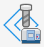
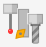

You turn the Groove Block model into a CNC program. Fusion's Manufacture workspace works out the cutter's path, checks it in a simulation, and writes the G-code file the Nomad 3 runs in the next lesson. These steps are for the current version of Autodesk Fusion.

- **Learning objective:** We are learning to turn a 3D model into a safe CNC program.
- **Prior knowledge:** [Groove Block 1: Make the Object](../lesson-00-groove-block/) (you bring the finished Groove Block design)
- **File you need:** your **Groove Block** design from the last lesson, open in Fusion
- **Time:** about one class period

**The Groove Block series:** [1 Make the object](../lesson-00-groove-block/) · 2 Toolpath and post (this lesson) · [3 Set up the Nomad and run the part](../../nomad/lesson-00-groove-block-run/)

### Success criteria

- I can set up stock, a top-centre work zero and a cutting tool in Fusion.
- I can make and simulate a 2D Pocket, and post a .nc file with the Carbide 3D post.

### Key vocabulary

| Word | Meaning |
| --- | --- |
| **CAM** | Computer-aided manufacturing: using software to plan how a machine cuts a part. |
| **Stock** | The raw block of material the machine cuts the part from. |
| **WCS** (work coordinate system) | The X, Y, Z zero point that the program measures every move from. |
| **Toolpath** | The route the cutter follows, calculated by Fusion. |
| **G-code** | The text commands (G0, G1, M3) that tell a CNC machine how to move. |
| **Post processor** | A translator that turns a Fusion toolpath into G-code for one brand of machine. |
| **Spindle speed** (rpm) | How fast the cutter spins, in revolutions per minute. |
| **Feed rate** | How fast the cutter moves through the material, in inches per minute (in/min). |
| **Chip load** | How thick a chip each flute takes on every turn. |
| **Stepdown** | How deep the cutter goes on each level. |
| **Stepover** | How far the cutter moves sideways between laps. |

| Colour | Meaning |
| --- | --- |
| Green | Safe to change. No real effect on the cut. |
| Amber | Changes the load on the cutter and spindle. Fine at the values given. |
| Red | Use with caution. A wrong value can break the end mill or wreck the part. |

**Spindle speed**, **cutting feedrate** and **stepdown** are amber. The **WCS origin** and the **stock offset** (both in 1B) are red: if they are wrong, the cutter goes into the wrong place or the wrong depth.

### Where things are

| Thing | Where on the screen |
| --- | --- |
| **Workspace switcher** (DESIGN / MANUFACTURE) | Fusion: far left of the toolbar, top-left |
| **MILLING** tab (MANUFACTURE) | Fusion: toolbar after switching to MANUFACTURE. **SETUP** group: New Setup  · **2D** group: 2D Pocket  · **ACTIONS** group: Simulate , Post Process  · **MANAGE** group: Tool Library  |
| **Browser** | Fusion: left side, under the toolbar. Document Settings, bodies, sketches, Setups |
| **ViewCube** and **Home**  | Fusion: top-right corner of the canvas. The Home button shows only when the mouse is near the ViewCube |

```brief
Part 1 · Setup and tool
1A · Manufacture | DESIGN ▾ → MANUFACTURE | Toolbar shows MILLING
1B · Setup | Origin: stock box point, top centre | Stock: No additional stock (101.6 × 76.2 × 25.4 mm)
1C · Tool #1 | 1/4 in flat end mill, 2 flutes | 10,000 rpm · 10 in/min (amber)
Part 2 · Toolpath and post
2A · 2D Pocket | Groove floor (the ring) | 0.01 steps · stepover 0.1 · ramp 2°
2B · Simulate | ACTIONS → Simulate | 7 levels, no red marks
2C · Post | Carbide 3D (Grbl) post | Save 1001.nc
Extra · Finished early? (optional)
Job time | About 15 in per level × 7 ÷ 10 in/min | About 11 min · compare to Simulate
```

## Part 1 · Setup and tool

### 1A · Switch to Manufacture

1. Click the **DESIGN ▾** box (the workspace switcher, far left of the toolbar). A list of workspaces drops down. Click **MANUFACTURE**. The box now says MANUFACTURE and the toolbar changes to **MILLING** tools.

@figure ../../assets/fusion/workspace-menu.png The workspace list under the DESIGN ▾ box. MANUFACTURE is about two-thirds of the way down.

@figure ../../assets/fusion/manufacture-toolbar.png The MILLING tab of the MANUFACTURE toolbar. From left: SETUP, 2D, 3D, DRILLING, MULTI-AXIS, MODIFY, ACTIONS, MANAGE, INSPECT and SELECT. This lesson uses SETUP, 2D, ACTIONS and MANAGE.

### 1B · The Setup: stock and work zero

The Setup tells Fusion what the stock is, where zero is, and which way is up. If any of these is wrong, the machine cuts in the wrong place.

| Setup setting | Value | Why |
| --- | --- | --- |
| Operation Type | Milling | The Nomad is a 3-axis mill |
| Orientation | Z up, X along the 4 in side | Matches how the block sits in the Nomad |
| Origin (red) | Stock box point: top centre | Zero in the middle of the block; the Nomad lesson sets the same point |
| Stock | Relative size box, No additional stock (101.6 × 76.2 × 25.4 mm = 4 × 3 × 1 in) | The block is already cut to size; only the groove is machined |
| Program | 1001, WCS offset 0 | Names the file; uses G54, the default work offset |

1. Under **SETUP** on the toolbar, click **New Setup**  (the first button). The **Setup** box opens on the right, on its **Setup** tab. An orange box (the stock) appears around the part.

@figure setup-menu.png New Setup is the first button under SETUP. It is also the first item in the SETUP ▾ list, if you open that instead.
2. Leave **Machine** empty (don't click Select...). Check **Operation Type** says **Milling**.
3. Under **Work Coordinate System (WCS)**, set **Orientation** to **Model orientation**. The WCS arrows show Z pointing straight up out of the top face. If Z points sideways, choose **Select Z axis/plane & X axis**, click the top face, then click the front 4 in edge.
4. Set **Origin** to **Stock box point**. A **Stock Point** line appears under it with a blue **Box Point** button, already pressed. Small dots appear on the corners, edges and faces of the stock box. Click the dot in the **centre of the top face**. The WCS arrows jump to the middle of the top.

@figure setup-tab.png The Setup tab: Machine left empty, Operation Type Milling, Orientation Model orientation, Origin Stock box point with the Box Point button pressed, and Model showing Body.

@figure wcs-top-centre.png Work zero on the top centre. The white dots are the stock box points you can pick. After clicking the dot in the middle of the top, the arrows start there: blue Z up, red X to the right, green Y to the back.
5. Check that **Model** shows **Body** (your block). Leave **Fixture** and **Accessibility Analysis** alone.
6. Click the **Stock** tab. Leave **Mode** on **Relative size box**. Fusion starts with 1 mm of extra stock added to the sides and top, as in the picture below.

@figure stock-tab-default.png The Stock tab as it first opens: Relative size box, with 1.00 mm added to the sides and top. Stock Dimensions shows 103.6 × 78.2 × 26.4 mm, a little bigger than the block. The next step takes that extra away.

7. Click the **Stock Offset Mode** list and choose **No additional stock**. The offset boxes go away and **Stock Dimensions** changes to **101.6 × 76.2 × 25.4 mm**. That is exactly 4 × 3 × 1 in (Fusion shows CAM sizes in mm here), so the stock box now sits right on the block.

@figure stock-no-additional.png Stock Offset Mode set to No additional stock. Stock Dimensions now read 101.6 (behind the list) × 76.2 × 25.4 mm: exactly the 4 × 3 × 1 in block.

> **Why this matters:** the work zero you picked is the centre of the **stock** top. With 1 mm of extra stock, zero would float 1 mm above the real block and the groove would come out 1 mm too shallow.
8. Click the **Post Process** tab. Set **Program Name/Number** to **1001** and **Program Comment** to **Groove Block**. Leave **WCS Offset** at **0**.
9. Click **OK**. **Setup1** appears in the Browser.

**Quick notes:** Zero = top of the stock in Z, centre of the block in X and Y, the same spot as the design origin. Every Z move in the program is negative, into the metal. The groove bottom is Z −0.0625.

### 1C · Make the 1/4 in end mill

| Cutting data | Value |
| --- | --- |
| Spindle speed (amber) | 10,000 rpm |
| Cutting feedrate (amber) | 10 in/min |
| Feed per tooth (chip load) | 0.0005 in |
| Plunge feedrate | 2 in/min |
| Ramp feedrate | 5 in/min |
| Coolant | Disabled |
| Tool number | 1 |

1. Under **MANAGE** on the toolbar, click **Tool Library**  (the first button). The **Tool Library** window opens.
2. On the left, under **My Libraries**, click **Local**. Click the **+** (New tool) button at the top and choose **Flat end mill**.
3. On the **Cutter** tab, enter the numbers from your end mill's package. Typical values for a 1/4 in 2-flute: **Number of flutes 2**, **Diameter 0.25**, **Shaft diameter 0.25**, **Flute length 0.75**, **Overall length 2.5**, **Body length 1**. Set **Unit** to **inches** if it isn't already.
4. On the **Post processor** tab, set **Number** to **1**. Carbide Motion uses this number when it asks you to load the tool.
5. On the **Cutting data** tab, enter the values in the table above. Set **Coolant** to **Disabled**.
6. On the **Info** tab, type the description **1/4 2FL aluminum**. Click **Accept**. The tool appears in the list. Close the Tool Library.

**Quick notes:** 10,000 rpm × 2 flutes × 0.0005 in = 10 in/min. These are cautious starting numbers. Carbide 3D publishes no 1/4 in aluminum recipe for the Nomad, and owners report its 130 W spindle struggles with 1/4 in tools in aluminum ([Carbide 3D forum](https://community.carbide3d.com/t/nomad-3-bogging-down/44765)). Test on a scrap block first.


- [ ] **Setup1** shows the WCS in the centre of the top of the stock, with Z up
- [ ] Stock Dimensions read 101.6 × 76.2 × 25.4 mm (4 × 3 × 1 in)
- [ ] Tool **#1** is a 1/4 in 2-flute flat end mill at 10,000 rpm and 10 in/min

## Part 2 · Toolpath and post

### 2A · The 2D Pocket toolpath for the groove

| 2D Pocket setting | Value |
| --- | --- |
| Tool | #1, 1/4 2FL aluminum |
| Geometry | The groove floor (the flat ring at the bottom of the groove) |
| Bottom height | Selected contour(s), offset 0 (Z −0.0625) |
| Maximum Stepover | 0.1 in |
| Multiple Depths (amber) | On, Maximum Roughing Stepdown 0.01 in (7 levels) |
| Ramp | Profile ramp, 2° |

1. Under **2D** on the toolbar, click **2D Pocket**  (the second button). The **2D Pocket** box opens on its **Tool** tab.
2. Click **Select** beside **Tool**. Pick **1/4 2FL aluminum** and click **Select**. The feeds and speeds fill in from the tool.
3. Click the **Geometry** tab. Click the **floor of the groove**, the flat ring at the bottom. The whole ring turns blue. Fusion knows to stay between the outer wall and the island.
4. Click the **Heights** tab. Leave **Top Height** at **Stock top**. Check **Bottom Height** says **Selected contour(s)** with **Offset 0**.
5. Click the **Passes** tab. Set **Maximum Stepover** to **0.1 in**. Tick **Multiple Depths** and set **Maximum Roughing Stepdown** to **0.01 in**. Leave **Stock to Leave** unticked.
6. Click the **Linking** tab. Under **Ramp**, set **Ramp Type** to **Profile** and **Ramp Angle** to **2 deg**, so the cutter slopes into the metal along the groove instead of plunging straight down.
7. Click **OK**. Fusion calculates and lines fill the groove. **2D Pocket1** appears under Setup1.

**Quick notes:** The 1/4 in cutter in a 1/2 in groove makes about two laps per level: one along the outer wall and one along the island. The stepover keeps the cutter overlapping, so no thin strip is left in the middle.

### 2B · Simulate

1. In the Browser, click **Setup1**. Under **ACTIONS** on the toolbar, click **Simulate**  (the first button). The **Simulate** box opens and the stock turns solid.
2. Press **Play** along the bottom. Watch the cutter ramp in and clear the groove in seven levels, two laps each.
3. Check that the groove is cut and nothing else is touched. Red marks on the bottom timeline mean a collision or a cut in the wrong place: stop and fix the Setup or the pocket selection.
4. Note the **Machining time** in the Simulate box (about 11 to 14 minutes is expected). Click **Close**.

### 2C · Post with the Carbide 3D post processor

| Post setting | Value |
| --- | --- |
| Post processor | Carbide 3D (Grbl), carbide3d.cps, from the Fusion Library |
| Program name | 1001 |
| Units | Inches |

1. With **Setup1** selected, click **Post Process**  (the **G1 G2** button under **ACTIONS**). The **Post Process** window opens.
2. Click the post processor list, search for **Carbide 3D** and choose **Carbide 3D (Grbl)** from the **Fusion Library** ([Carbide 3D: Fusion 360](https://docs.carbide3d.com/software-faq/fusion360/)). Tick its star to keep it in your favourites.
3. Check **Program name** is **1001** and **Units** are **Inches**. Choose an **Output folder** you can reach from the Nomad's computer (USB stick or shared drive).
4. Click **Post**. A **1001.nc** file is saved and usually opens in a text window.
5. Look at the first lines. You should see **G20** (inches), **T1**, **S10000 M3** (spindle on at 10,000 rpm) and a **G0** move to a safe height. Close the window.

> **Licence note:** On the free Personal use licence of Fusion, rapid moves are slowed to the cutting feed, so the job runs longer. The school Education licence does not have that limit.

- [ ] **2D Pocket1** clears the whole groove in seven levels with no red marks
- [ ] A **1001.nc** file is saved where the Nomad computer can reach it

## Extra · Finished early?

Optional.

- **Work out the job time by hand:** at each level the cutter makes an outer lap of about **8.4 in** and an inner lap around the island of about **6.8 in**, about **15 in** in all. Seven levels at 10 in/min is about **11 minutes**. Compare that with Fusion's Simulate time and explain the difference (ramps, rapid moves).

## Troubleshooting

| Problem | Fix |
| --- | --- |
| The WCS arrows are on a corner, not the middle | Double-click **Setup1** in the Browser, click **Box Point** again and pick the dot in the centre of the top. |
| Stock Dimensions are bigger than 101.6 × 76.2 × 25.4 mm | Set **Stock Offset Mode** to **No additional stock**. With extra stock, zero floats above the block and the groove comes out too shallow. |
| Fusion says the toolpath is empty | Check the Geometry tab has the groove **floor** (the ring) selected, not an edge or the top face. |
| Simulation cuts the island or outside the groove | Re-select only the groove **floor**. If the island is selected too, Fusion pockets it away. |
| Can't find the Carbide 3D post | In the post list, search **Carbide** and make sure the **Fusion Library** is searched, not only your own posts. |
